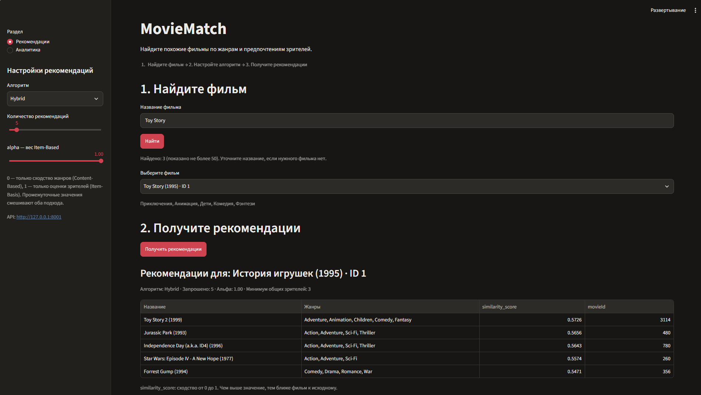
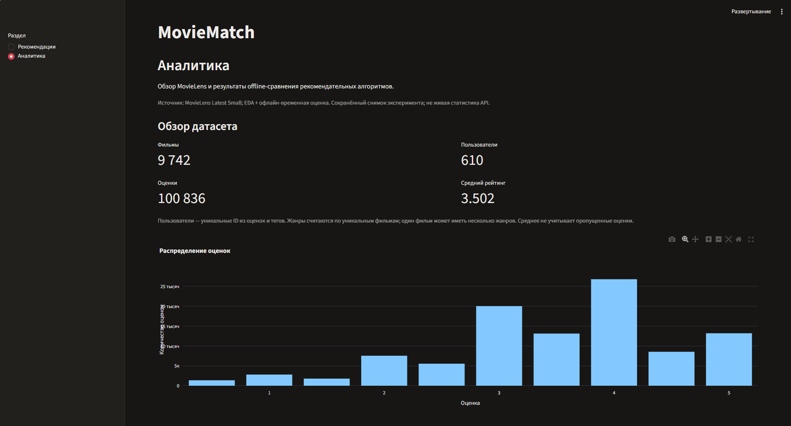
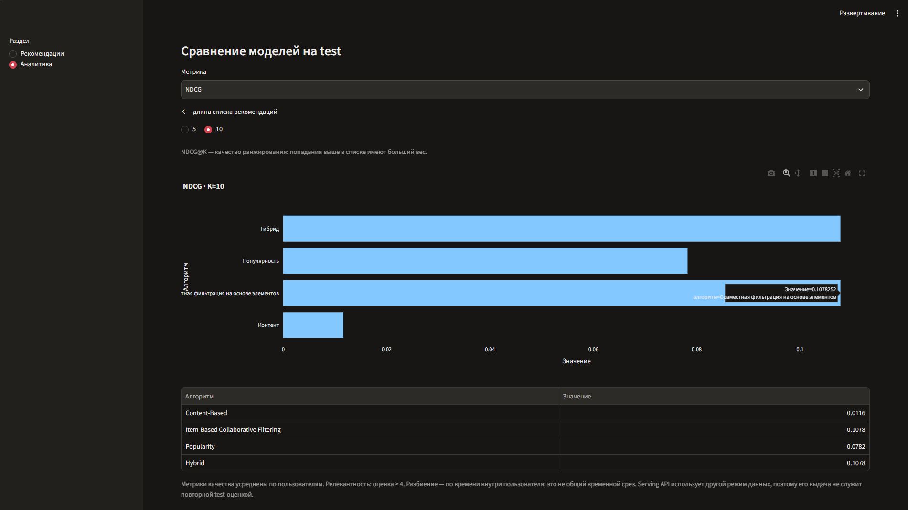
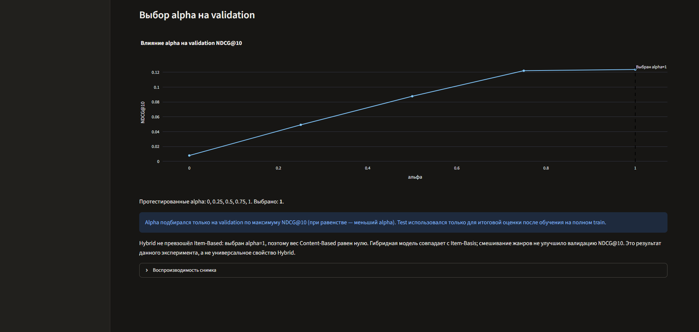
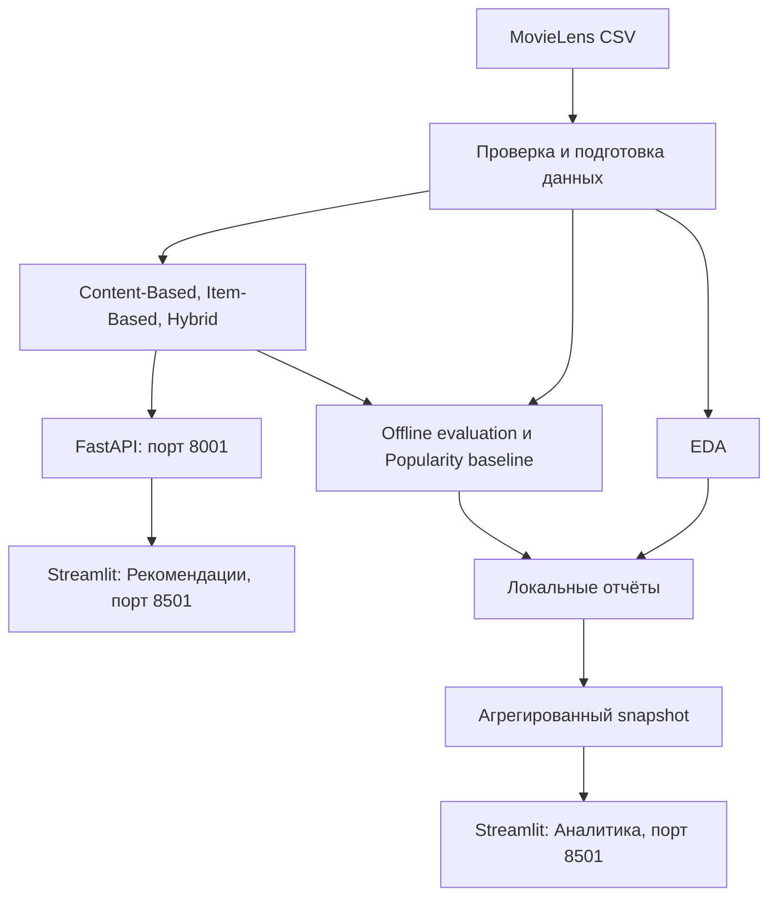

# MovieMatch — система рекомендаций фильмов

[](https://github.com/itaminy/MovieMatch/actions/workflows/ci.yml)

Учебный проект для портфолио Data Analyst / Data Scientist: от проверки данных и EDA до сравнения рекомендательных алгоритмов, REST API и аналитического дашборда.

## Описание проекта и решаемой задачи

MovieMatch помогает найти фильмы, похожие на выбранный, используя жанры и пользовательские оценки. Аналитическая часть отвечает на вопрос: какой из реализованных подходов лучше ранжирует будущие понравившиеся фильмы пользователя?

Проект объединяет проверку качества CSV, исследование распределений, воспроизводимую offline-оценку и демонстрацию результатов в приложении. Лучший NDCG@10 среди проверенных подходов получили Item-Based и совпавший с ним Hybrid: **0,107825**. Это результат одного offline-эксперимента; влияние на пользовательские или бизнес-показатели не измерялось. Документация описывает локальный запуск, облачное развёртывание не заявляется.

## Основные возможности

- Поиск фильма по названию и выбор по `movieId`, включая одинаковые названия.
- Рекомендации Content-Based, Item-Based и Hybrid: 1–50 фильмов, жанры и `similarity_score`; исходный фильм исключён.
- Настройка веса `alpha` для Hybrid, обработка ошибок API и сохранение актуальных результатов в состоянии Streamlit.
- Страница «Аналитика»: показатели датасета, распределение оценок, топ-10 жанров и фильмов, сравнение четырёх моделей с выбором метрики и K, график подбора alpha.
- Автоматические тесты и workflow GitHub Actions без реального MovieLens и запущенных серверов.

## Демонстрация проекта

### Рекомендации фильмов

Поиск и выбор исходного фильма, настройки алгоритма и таблица полученных рекомендаций.



### Распределение оценок

Обзор датасета и распределение пользовательских оценок на странице аналитики.



### Сравнение рекомендательных моделей

Сравнение качества Content-Based, Item-Based, Popularity и Hybrid с выбором метрики и K. Методология и точные значения приведены в разделе «Сравнение качества моделей» ниже.



### Подбор alpha

Зависимость validation NDCG@10 от веса alpha и выбранное значение 1. Validation используется для подбора веса, test — для итоговой оценки.



## Технологический стек

| Задача | Инструменты |
|---|---|
| Язык и окружение | Python 3.14, pip, venv |
| Данные и матрицы | Pandas, NumPy, SciPy CSR |
| Рекомендательные модели | Scikit-learn: TF-IDF, косинусное сходство |
| EDA и визуализация | Matplotlib, Plotly |
| REST API | FastAPI, Pydantic, Uvicorn |
| Интерфейс и HTTP-клиент | Streamlit, httpx |
| Проверки | Pytest, FastAPI TestClient, Streamlit AppTest, GitHub Actions |

Диапазоны зависимостей заданы в [requirements.txt](requirements.txt). SQLite не используется как хранилище в текущем сценарии: данные читаются из CSV, модели работают в памяти.

## Датасет MovieLens Latest Small

Источник — [официальный архив GroupLens](https://files.grouplens.org/datasets/movielens/ml-latest-small.zip). Формат и условия использования описаны в [README датасета](https://files.grouplens.org/datasets/movielens/ml-latest-small-README.html).

В сохранённом [snapshot](dashboard_data/snapshot.json): **9 742 фильма**, **610 пользователей**, **100 836 оценок**; средняя оценка — **3,5016**. Пользователи считаются по объединению ratings и tags. Оценки имеют шкалу 0,5–5 с шагом 0,5.

| Файл | Содержимое |
|---|---|
| `movies.csv` | Идентификаторы, названия, жанры |
| `ratings.csv` | Пользователь, фильм, оценка, timestamp |
| `tags.csv` | Пользовательские теги |
| `links.csv` | Внешние идентификаторы IMDb и TMDb |

[Загрузчик](ml/data_loader.py) проверяет наличие четырёх файлов, обязательные поля, типы и допустимые значения. Пропуски и дубликаты сохраняются для EDA; правила очистки для моделей и evaluation задаются отдельно. Теги и внешние идентификаторы не используются как признаки текущих рекомендательных моделей.

CSV и ZIP MovieLens исключены через [.gitignore](.gitignore). Полный датасет не нужно добавлять в Git. Архив `latest` может обновляться: точное повторение эксперимента требует той же версии CSV. Offline-отчёт сохраняет SHA-256 входных movies/ratings и версии библиотек; snapshot — хэши исходных отчётов. Зависимости заданы диапазонами, а не lock-файлом.

## Анализ данных (EDA)

[ml/eda.py](ml/eda.py) рассчитывает пропуски и дубликаты, размеры таблиц, средние рейтинги, частоты оценок и жанров, количество оценок на фильм и топ-10 фильмов. Жанры разделяются по `|`: один фильм может относиться к нескольким категориям. Маркер отсутствия жанра не учитывается; среднее пропускает пустые оценки.

Факты из snapshot:

- Чаще всего встречаются Drama — 4 361 фильм, Comedy — 3 756, Thriller — 1 894.
- Самая частая оценка — 4,0: 26 818 наблюдений.
- Больше всего оценок у Forrest Gump (1994) — 329. Это лидер по числу оценок, а не по среднему рейтингу.

EDA сохраняет `reports/summary.json` и четыре PNG в `reports/figures/`. Эти локальные отчёты исключены из Git. Для дашборда хранится компактный обезличенный [dashboard_data/snapshot.json](dashboard_data/snapshot.json): агрегаты и метрики без пользовательских ID и сырых оценок. Аналитика читает кешируемый снимок и не выполняет полный анализ при перерисовках.

## Реализованные рекомендательные алгоритмы

| Алгоритм | Подход | Особенность |
|---|---|---|
| [Content-Based](ml/content_based.py) | TF-IDF жанров и косинусное сходство | Не использует оценки; `Sci-Fi` и `Film-Noir` сохраняются как целые жанры |
| [Item-Based Collaborative Filtering](ml/collaborative.py) | Косинусное сходство сырых векторов оценок в разреженной матрице «фильмы × пользователи» | Требует минимум 3 общих пользователей; без центрирования рейтингов |
| [Popularity](ml/evaluation.py) | Число уникальных оценивших пользователей в train | Неперсонализированный baseline только для offline-сравнения |
| [Hybrid](ml/hybrid.py) | Линейная комбинация Content-Based и Item-Based | `score = alpha × CF + (1 − alpha) × CB` |

`alpha=0` означает Content-Based, `alpha=1` — Item-Based. В API и UI значение по умолчанию — 1,0, согласно сохранённому эксперименту; конструктор класса Hybrid по умолчанию использует 0,5. Сходство не является вероятностью интереса или прогнозом оценки. Полная матрица сходства «все фильмы × все фильмы» не создаётся.

## Методология offline evaluation

Реализация: [ml/evaluation.py](ml/evaluation.py); команда эксперимента: [ml/run_evaluation.py](ml/run_evaluation.py).

1. Удаляются события с пропусками в обязательных полях. Для повторной пары пользователь–фильм сохраняется самое раннее событие; при одинаковом времени выбирается меньшая оценка.
2. Для каждого пользователя ранние примерно 80% событий идут в train, поздние — в test. Одинаковые timestamp не разделяются; весь train пользователя строго раньше его test. Требуется минимум 5 train-событий и 1 test-событие.
3. Оцениваются одинаковые для всех моделей пользователи с хотя бы одним положительным train-фильмом и релевантным test-фильмом. Порог релевантности — `rating >= 4`.
4. Каталог кандидатов состоит из train-фильмов. Для Content-Based и CF сходство суммируется по положительным train-фильмам пользователя; деление на число этих фильмов не изменяет порядок. Уже просмотренные фильмы и кандидаты с нулевым score исключаются. Popularity ранжирует по числу пользователей в train. Недостающие рекомендации не дополняются fallback-списком.
5. Внутри внешнего train создаётся ещё одно временное разбиение для validation. Alpha выбирается по максимуму validation NDCG@10 среди 0, 0,25, 0,5, 0,75 и 1; при равенстве выбирается меньший вес.
6. После выбора alpha компоненты обучаются на полном внешнем train. Test используется только для итогового сравнения при K=5 и K=10. Параметры по test не подбираются.

Временное разделение приближает задачу к рекомендации будущих взаимодействий и предотвращает обучение на более поздних оценках того же пользователя. Это **разбиение внутри пользователя**, а не единая временная граница для всего датасета: глобальная временная утечка между пользователями полностью не исключена.

Precision, Recall и NDCG усредняются по пользователям. Precision@K — доля попаданий среди K позиций; Recall@K — доля найденных релевантных test-фильмов; NDCG@K учитывает порядок и сильнее вознаграждает попадания наверху. Coverage@K — доля train-каталога, встретившаяся хотя бы в одном top-K списке.

Accuracy классификации здесь не отражает задачу: модель ранжирует большой каталог, а отсутствие оценки не означает отрицательный интерес. Число «правильно не рекомендованных» фильмов могло бы доминировать в accuracy, скрывая качество верхних позиций. Поэтому оцениваются попадания, порядок и покрытие.

## Сравнение качества моделей

Источник всех значений ниже — [сохранённый snapshot](dashboard_data/snapshot.json), разделы `metrics` и `validation`. Метрики качества приведены в долях, Coverage — в процентах; округление до шести и четырёх знаков соответственно.

| Модель | Precision@10 | Recall@10 | NDCG@10 | Coverage@10 |
|---|---:|---:|---:|---:|
| Content-Based | 0.008814 | 0.009311 | 0.011639 | 11.3570% |
| Item-Based Collaborative Filtering | **0.086271** | **0.081192** | **0.107825** | 5.6542% |
| Popularity | 0.060339 | 0.050358 | 0.078234 | 1.1916% |
| Hybrid, alpha=1 | **0.086271** | **0.081192** | **0.107825** | 5.6542% |

Item-Based разделил первое место с Hybrid по трём метрикам качества, но не по покрытию: Content-Based охватывает больше каталога. Возможное объяснение преимущества CF — оценки отражают совместные предпочтения зрителей, тогда как жанры дают более грубое описание фильма. Это интерпретация наблюдаемого результата; отдельного эксперимента, доказывающего причину разницы, не проводилось.

| Alpha | Validation NDCG@10 |
|---:|---:|
| 0 | 0.007930 |
| 0.25 | 0.049267 |
| 0.5 | 0.087698 |
| 0.75 | 0.122120 |
| **1** | **0.123775** |

**Оптимальное alpha=1 — лучший вес среди проверенных на validation.** Вклад жанровой модели стал нулевым; Hybrid превратился в Item-Based и не улучшил test-метрики. Промежуточные веса не повысили validation NDCG@10. Это не доказывает бесполезность гибридных моделей в других данных или при других признаках.

## Архитектура проекта



Стрелки показывают поток данных; serving и offline-эксперимент создают отдельные экземпляры моделей. **API использует все локальные оценки**, включая отложенные offline-процессом в test. Поэтому выдача API не служит повторной проверкой test-метрик. Streamlit получает рекомендации только через HTTP; EDA, обучение и evaluation не запускаются из интерфейса.

```text
backend/                 # FastAPI: маршруты, схемы, сервис моделей
frontend/                # Streamlit, HTTP-клиент, аналитика и экспорт snapshot
ml/                      # Загрузчик, EDA, алгоритмы и offline evaluation
tests/                   # Фикстуры, ML/API/HTTP/UI-тесты
dashboard_data/          # Компактный снимок для аналитики в Git
docs/screenshots/        # Реальные скриншоты и описание
data/ml-latest-small/    # Локальные CSV, вне Git
reports/                 # Генерируемые EDA/evaluation-отчёты, вне Git
.github/workflows/ci.yml # Автоматические проверки
requirements.txt         # Зависимости
```

Основные маршруты: `GET /health`, `GET /movies`, `GET /movies/{movie_id}`, `GET /recommendations/{movie_id}`. Рекомендации принимают `method=content_based|item_based|hybrid`, `top_n=1..50`, `alpha=0..1`. Неизвестный фильм даёт 404, неверные параметры — 422. Полный контракт — в Swagger после запуска API.

## Установка и запуск на Windows

Все команды выполняются в **PowerShell из корня репозитория**. Нужен установленный 64-битный Python 3.14.

### Окружение и зависимости

```powershell
git clone https://github.com/itaminy/MovieMatch.git
cd MovieMatch
py -3.14 -m venv venv
.\venv\Scripts\Activate.ps1
python -m pip install -r requirements.txt
python -m pip check
```

Если `venv` уже существует, повторно создавать его не нужно. Если PowerShell блокирует активацию, используйте `.\venv\Scripts\python.exe` вместо `python` во всех командах ниже; менять политику выполнения не требуется.

### Загрузка MovieLens

```powershell
New-Item -ItemType Directory -Force data | Out-Null
Invoke-WebRequest -Uri "https://files.grouplens.org/datasets/movielens/ml-latest-small.zip" -OutFile "data/ml-latest-small.zip" -ErrorAction Stop
Expand-Archive -LiteralPath "data/ml-latest-small.zip" -DestinationPath "data" -Force -ErrorAction Stop
python -c "from ml.data_loader import load_data; print({name: len(frame) for name, frame in load_data().items()})"
```

Ожидаются `movies.csv`, `ratings.csv`, `tags.csv`, `links.csv` в `data/ml-latest-small/`. При недоступной сети скачайте официальный архив в браузере и распакуйте в `data/`. Данные нужны для API и пересчёта эксперимента, но не для тестов или просмотра готовой аналитики.

### FastAPI и Streamlit

В первом терминале:

```powershell
python -m uvicorn backend.main:app --reload --host 127.0.0.1 --port 8001
```

Проверка: <http://127.0.0.1:8001/health>; Swagger: <http://127.0.0.1:8001/docs>.

Во втором терминале из корня проекта:

```powershell
.\venv\Scripts\Activate.ps1
python -m streamlit run frontend/app.py --server.port 8501
```

Откройте <http://localhost:8501>. Найдите `Toy Story`, выберите фильм, алгоритм и нажмите «Получить рекомендации». В боковой панели доступна «Аналитика», работающая по включённому в Git snapshot даже без API. Для остановки серверов нажмите `Ctrl+C` в каждом терминале.

HTTP-клиент по умолчанию обращается к `http://127.0.0.1:8001`. Другой адрес задаётся перед запуском Streamlit:

```powershell
$env:MOVIEMATCH_API_URL = "http://127.0.0.1:8001"
python -m streamlit run frontend/app.py --server.port 8501
```

### EDA, offline evaluation и обновление дашборда

После загрузки CSV выполните отдельно в терминале:

```powershell
python -m ml.eda
python -m ml.run_evaluation
python -m frontend.prepare_dashboard
```

Первая команда создаёт EDA-отчёт и PNG; вторая — `metrics.csv`, `validation_metrics.csv`, `summary.json` в `reports/evaluation/`. Полная evaluation может занять время. Третья команда проверяет и экспортирует агрегаты в `dashboard_data/snapshot.json` без обучения. Если отчёты уже есть, достаточно третьей команды.

Доступны параметры `--data-dir` и `--output-dir` у EDA/evaluation, `--reports-dir` и `--output` у экспорта snapshot. При отсутствии или повреждении snapshot аналитика показывает инструкции подготовки. Для воспроизведения сохранённых чисел нужны исходные версии данных и окружения; новый `latest` может дать другой результат.

## Запуск тестов и GitHub Actions

Из корня проекта в активированном окружении:

```powershell
python -m pytest -q
python -m pip check
python -c "import backend.main; import frontend.app"
```

Тесты проверяют загрузчик и EDA, формулы и ранжирование моделей, временное разбиение, выбор alpha, API-контракты, HTTP-ошибки, состояние рекомендаций и навигацию аналитики. Используются небольшие синтетические таблицы, временные CSV, моки HTTP и сохранённые агрегаты. Настоящий MovieLens, запущенные серверы и полная offline evaluation не нужны.

[CI workflow](.github/workflows/ci.yml) запускается при `push` и `pull_request`: `ubuntu-latest`, Python 3.14, кэш pip, установка зависимостей, `pip check`, проверка импортов и `python -m pytest -q`. Пользовательские секреты не требуются; разрешение — только `contents: read`.

Статус конкретного коммита проверяйте во вкладке [Actions](https://github.com/itaminy/MovieMatch/actions/workflows/ci.yml) или Checks pull request. Зелёный означает прохождение всех шагов, красный — необходимость изучить лог первого неуспешного шага. Отменённый запуск не подтверждает работоспособность. Локальные проверки не доказывают успешный запуск GitHub Actions.

## Ограничения проекта и возможные улучшения

- Один небольшой датасет и один временной протокол: выводы нельзя автоматически переносить на другие каталоги. Полезны несколько временных срезов и оценка неопределённости метрик.
- Оценены только пользователи с положительной историей и релевантным test. Cold start и фильмы вне train-каталога ограничивают покрытие; нужны отдельные сценарии оценки и fallback.
- Content-Based использует только жанры; возможны признаки из описаний и тегов. Item-Based использует сырые оценки без центрирования и чувствителен к разреженности и популярности.
- UI рекомендует соседей выбранного фильма; пользовательская агрегация истории реализована в offline evaluation, но не представлена как персонализированный аккаунт в приложении.
- Нет онлайн A/B-теста, оценки разнообразия и новизны, мониторинга качества или доказанного бизнес-эффекта.
- Для больших данных нужны замеры памяти и задержек, оптимизация поиска кандидатов и стратегия обновления моделей. Текущий serving держит модели в памяти процесса.
- Для более строгой воспроизводимости полезны lock-файл зависимостей и фиксированная версия исходных данных.
